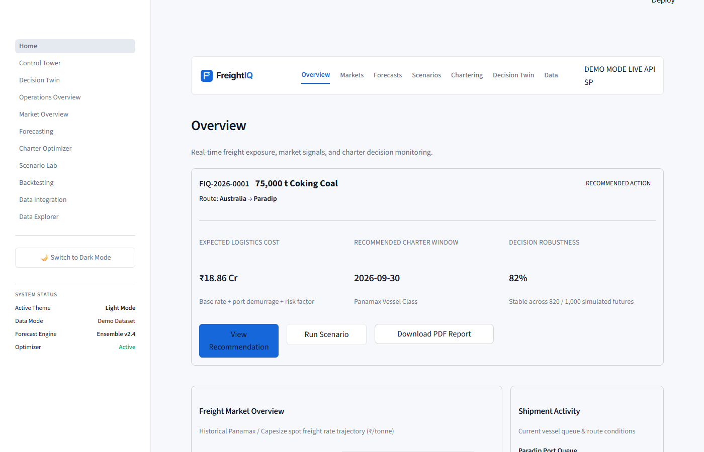
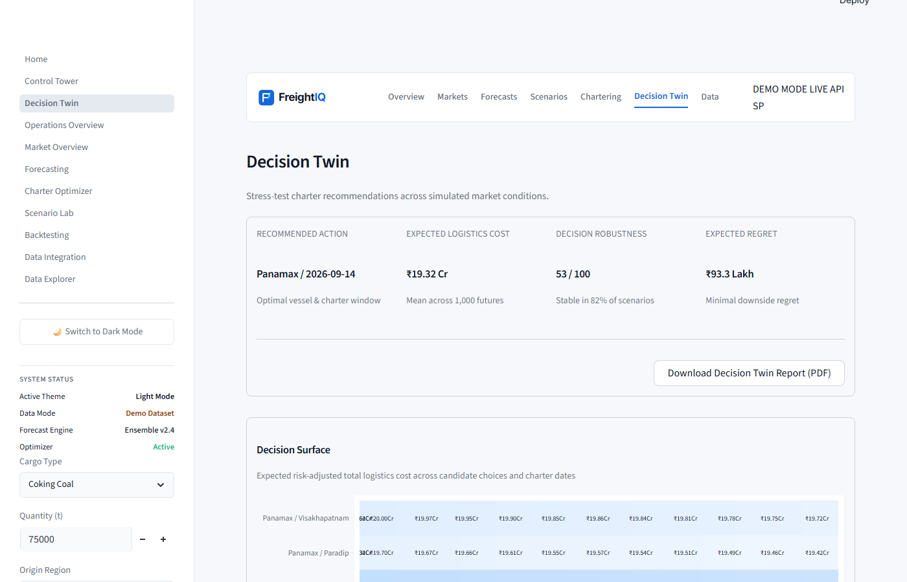
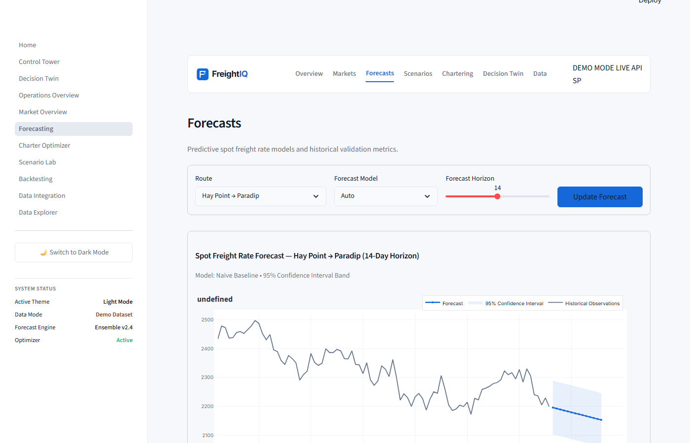
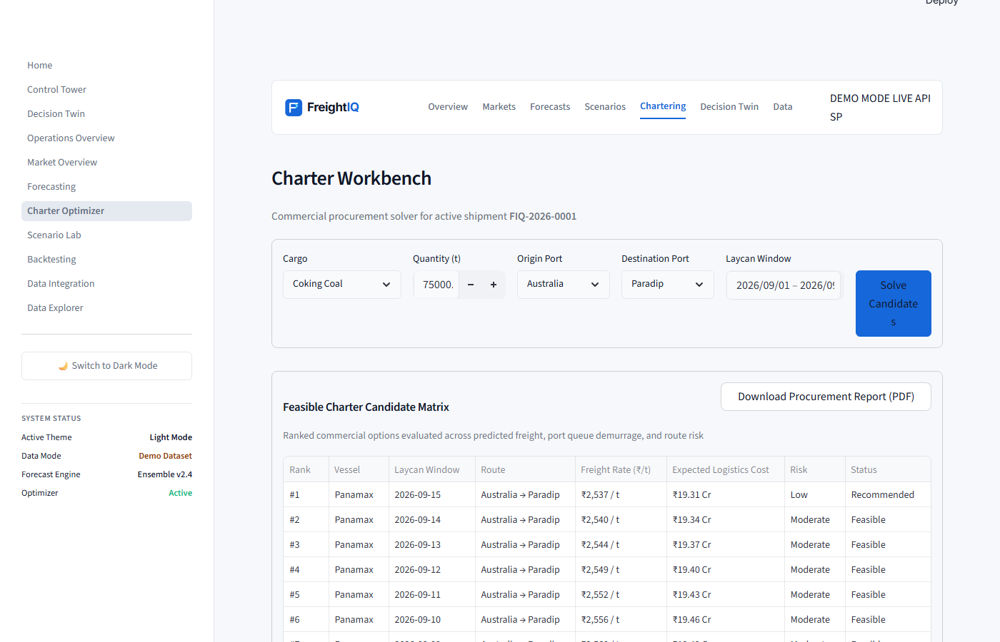
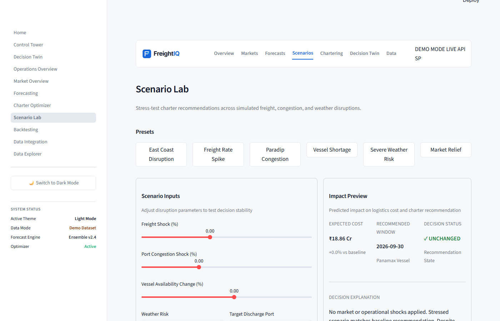
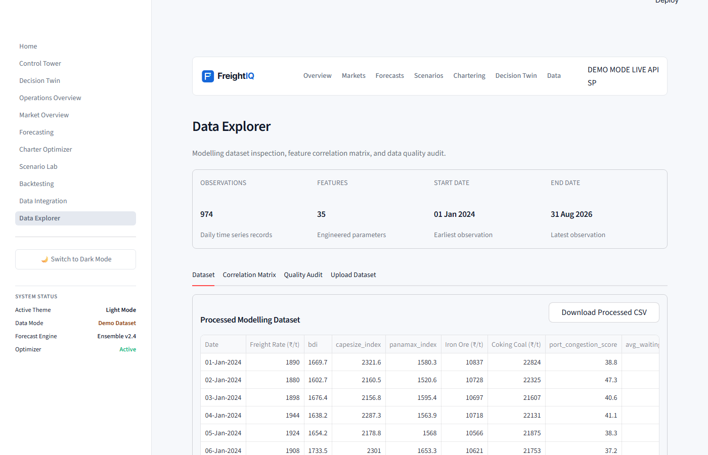
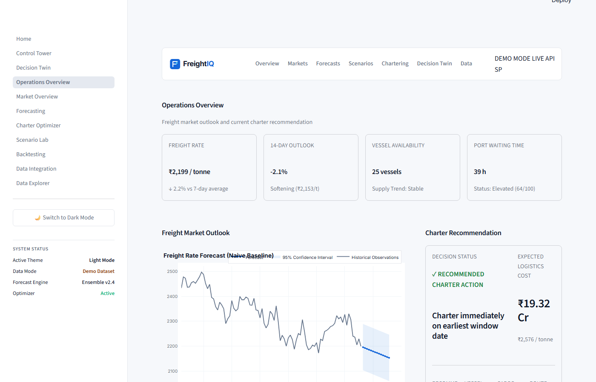

# FreightIQ

## Maritime freight intelligence for faster, safer charter decisions

FreightIQ is a decision-support platform for bulk-cargo procurement teams operating on India’s east coast. It combines route-specific market history, freight-rate forecasting, charter timing optimization, operational risk analysis, scenario simulation, and explainable decision reports in one workflow.

> SIH 2026 project by the FreightIQ team. The project progressed through our college’s institutional selection and was among the top 50 teams forwarded for the final-stage evaluation. The government-portal results are pending.



## What it does

- Forecasts route-level freight rates with a Naive Baseline and SARIMA model path.
- Recommends charter timing and vessel class under cargo, route, laycan, capacity, and risk constraints.
- Simulates disruption scenarios such as freight spikes, congestion, vessel shortages, and severe weather.
- Compares procurement policies through the Decision Twin and Strategy Arena.
- Runs historical-style walk-forward backtests against an immediate-charter benchmark.
- Produces explainable cost breakdowns, sensitivity analysis, audit notes, CSV views, and PDF decision reports.
- Serves both a polished browser command center and the original Streamlit analytical workspace.

## Screenshots

| Decision Twin | Forecasting | Charter Workbench |
| --- | --- | --- |
|  |  |  |

| Scenario Lab | Data Explorer | Operations |
| --- | --- | --- |
|  |  |  |

## Architecture

```text
Browser command center / Streamlit workspace
                    │
                    ▼
             FastAPI service
                    │
        ┌───────────┼───────────┐
        ▼           ▼           ▼
   Forecasting  Optimizer   Simulations
        │           │           │
        └───────────┴───────────┘
                    │
                    ▼
      Synthetic demo datasets + SQLite audit store
```

The browser client is served by Node.js and proxies `/api/*` requests to FastAPI. Python remains the source of truth for forecasts, optimization, scenario logic, backtesting, validation, and report generation.

## Quick start

### Requirements

- Python 3.11 or later
- Node.js 22 or later
- Git

### Install

```powershell
git clone https://github.com/prajwalsamsonck/freightiq.git
cd freightiq

python -m venv .venv
.\.venv\Scripts\Activate.ps1
python -m pip install -r requirements.txt
npm ci
Copy-Item .env.example .env
```

### Run the browser command center

Open two terminals from the repository root:

```powershell
# Terminal 1
python -m uvicorn backend.main:app --host 127.0.0.1 --port 8000
```

```powershell
# Terminal 2
npm run dev
```

Open [http://localhost:3000](http://localhost:3000). API documentation is available at [http://localhost:8000/docs](http://localhost:8000/docs).

### Run the Streamlit workspace

```powershell
streamlit run app/Home.py
```

Open [http://localhost:8501](http://localhost:8501).

## Verify the project

```powershell
python -m pytest -q
npm test
npm run build
```

The test suite covers API contracts, forecasting, optimizer constraints, route isolation, scenario determinism, report generation, UI smoke rendering, and browser proxy behavior.

## Configuration and data modes

The default configuration is offline and reproducible:

```env
DATA_MODE=DEMO
SIH_DEMO_MODE=true
IS_DEMO_DATA=True
```

Demo data is synthetic and included only for evaluation and demonstration. Optional connector variables are documented in `.env.example`; unset connectors report their availability without breaking the application.

## Project layout

```text
app/                 Streamlit pages and reusable UI components
backend/             FastAPI service and decision engines
config/              Model and decision parameters
data/                Synthetic demo datasets and generators
docs/                Architecture, verification, and project notes
screenshots/         Curated product screenshots
scripts/             Build and verification utilities
tests/               Python and Node test suites
web/                 Browser command-center client
```

## Project documentation

- [Project context](docs/PROJECT_CONTEXT.md)
- [Web interface architecture](docs/WEB_INTERFACE_ARCHITECTURE.md)
- [Feature mapping](docs/FEATURE_MAPPING.md)
- [Implementation status](docs/IMPLEMENTATION_STATUS.md)
- [Functional verification](docs/FUNCTIONAL_VERIFICATION.md)
- [Voyage Intelligence map](docs/VOYAGE_INTELLIGENCE.md)
- [Project Phoenix decision slice](docs/PROJECT_PHOENIX.md)

## Scope and limitations

FreightIQ is a hackathon prototype and decision-support demonstrator. It is not a live chartering system, a navigation product, a financial-advice service, or a substitute for commercial data validation. Production use would require licensed market feeds, real shipment histories, contract-specific cost calibration, security hardening, and operational approval.

## License

Released under the [MIT License](LICENSE).

## Team

Built by the FreightIQ team for SIH 2026.
